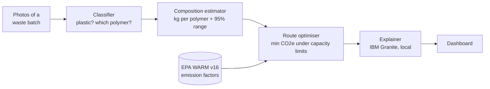

# PolyRoute

**Photos of mixed plastic waste in → the lowest-carbon route for every kilogram out.**

> We throw plastic away, but there is no "away".

PolyRoute identifies the plastics in a waste batch from photos, estimates how many kilograms of each polymer the
batch holds, and decides where each kilogram should go (recycling, composting, energy recovery or landfill) to
minimise greenhouse-gas emissions within a facility's real capacity limits. A local IBM Granite model then explains
the plan in plain language.

Built for the **IBM Z Datathon 2026**, Wildcard theme *"Beyond the Obvious"*, and run on **IBM LinuxONE** (s390x).

---

## Contents

- [How it works](#how-it-works)
- [Components](#components)
- [Repository layout](#repository-layout)
- [Quick start](#quick-start)
- [Running on IBM LinuxONE](#running-on-ibm-linuxone)
- [Data, models and sources](#data-models-and-sources)
- [Example result](#example-result)
- [Limitations](#limitations)
- [Open-source resources](#open-source-resources)
- [Team](#team)

---

## How it works



1. **Classify.** Each photo is classified as plastic or not, and plastic items are assigned one of seven classes:
   PET, HDPE, PVC, LDPE, PP, PS, Other.
2. **Estimate composition.** Item predictions become kilograms per polymer. The estimator corrects for the
   classifier's known mistakes using its confusion matrix, weights items by typical mass, estimates the batch weight
   when it isn't measured, and gives a 95% interval for every number.
3. **Optimise routes.** A linear programme sends each polymer's kilograms to the routes with the lowest net
   emissions (EPA WARM v16 factors), without exceeding recycling, composting or landfill capacity.
4. **Explain.** IBM Granite, running locally on CPU, turns the plan into a short explanation. If the model is
   unavailable, a template explanation is used instead.

**Why it goes beyond the obvious:** the lowest-carbon choice is often not the intuitive one. Under WARM, burning
plastic for energy emits more CO2e than landfilling it, LDPE film, PS and PVC have no recycling factor at all, and
when a facility is full the best plan can still be a net carbon *cost*. PolyRoute makes those trade-offs visible
and quantified for every batch.

---

## Components

| Module | Folder | What it does | Status |
|---|---|---|---|
| Classifier | `src/classifying_plastics/` | TensorFlow / Keras (MobileNetV3-Large): polymer class with probabilities; predictions below 0.60 confidence go to manual check | Trained; 84.3% accuracy on a 491-image test set; connected to the dashboard |
| Composition estimator | `src/comp_analyzer/` | Classifier records → kg per polymer with 95% intervals; batch-weight estimation | Complete |
| Route optimiser | `src/optimiser/` | Linear programme (PuLP + GLPK) over EPA WARM v16 factors and facility limits | Complete |
| Explainer | `src/explainer/` | IBM Granite 4.0 (GGUF) via llama-cpp-python, with a template fallback | Complete |
| Dashboard | `src/dashboard/` | Flask JSON API running the whole chain (photos → classifier → … → explainer), plus a React frontend (`frontend/`) and a plain HTML page | Working end to end |
| Checks | `src/checks/` | Step-by-step integration checks for the optimiser and explainer | In progress |

### Interfaces between modules

**Classifier → composition estimator**: one record per photo
```json
{"image": "img_0001.jpg", "material": "plastic", "polymer": "HDPE", "confidence": 0.99,
 "probs": {"PET": 0.003, "HDPE": 0.991, "PVC": 0.0, "LDPE": 0.001, "PP": 0.001, "PS": 0.003, "Other": 0.0}}
```
`material` is `plastic`, `non_plastic` or `uncertain`.

**Composition estimator → optimiser**
```json
{"composition_data": {"total_kg": 50.0,
                      "kg": {"PET": 9.86, "HDPE": 7.87, "LDPE": 1.6, "...": "..."},
                      "margin": {"PET": 0.21, "...": "..."},
                      "excluded": {"non_plastic": 9, "uncertain": 4}}}
```

**Optimiser → explainer / dashboard**
```json
{"plan": {"PET": {"recycle": 9.86}, "LDPE": {"landfill": 1.6}},
 "saved_kgco2e": 22.4, "notes": ["..."]}
```

---

## Repository layout

```text
polyRoute/
├── README.md
├── requirements.txt
└── src/
    ├── classifying_plastics/     # classifier (TensorFlow): classify.py, evaluate.py, polymer_classifier/
    │   ├── data/                 # predictions.json, confusion_matrix.json (real test set)
    │   └── models/               # trained model, best_polymer_model_tf.keras (not in git; copy it here)
    ├── comp_analyzer/            # composition estimator
    │   └── data/                 # item masses, weight parameters, classifier confusion matrix; synthetic/ (tests only)
    ├── optimiser/                # route_opt.py, factors.py
    │   └── data/                 # emission_factors.csv (EPA WARM v16)
    ├── explainer/                # explainer.py (Granite prompt, model loading, fallback)
    ├── dashboard/                # Flask backend (app.py, pipeline.py, integrations.py), plain HTML page
    │   └── frontend/             # React frontend (TanStack Start, Vite, Tailwind CSS)
    └── checks/                   # integration checks (in progress)
```

All commands below are run from `src/`.

---

## Quick start

**Requirements:** Python 3 (tested with 3.12 on LinuxONE), the GLPK solver, and about 3 GB of free RAM for the explainer.

```bash
git clone https://github.com/subho0025/polyRoute.git
cd polyRoute
python -m venv .venv && source .venv/bin/activate
pip install -r requirements.txt
pip install llama-cpp-python      # explainer only; builds from source (needs cmake and a C++ compiler)

# GLPK solver used by the optimiser
sudo dnf install glpk-utils       # Fedora
# sudo apt-get install glpk-utils # Ubuntu / Debian

cd src
```

**Composition estimator** on the classifier's real test-set output (50 kg, measured):
```bash
python -m comp_analyzer.demo classifying_plastics/data/predictions.json 50    # or: volume=1.2 / count=2000 / no weight
python -m comp_analyzer.tests                                               # unit tests (use synthetic batches)
```

**Optimiser** checks (hand-worked cases, edge cases, 500 random batches against an independent solver):
```bash
python -m checks.optimiser_check
```

**Explainer** with IBM Granite (download about 2 GB once):
```bash
pip install -U huggingface_hub
hf download ibm-granite/granite-4.0-h-micro-GGUF granite-4.0-h-micro-Q4_K_M.gguf --local-dir explainer
export POLYROUTE_GRANITE_GGUF=$PWD/explainer/granite-4.0-h-micro-Q4_K_M.gguf
python -m checks.explainer_check --quick
```

**Classifier** on a folder of images (needs the trained model in `classifying_plastics/models/`):
```bash
pip install -r classifying_plastics/requirements.txt
cd classifying_plastics && python3 classify.py path/to/images/ -o data/predictions.json
```

**Dashboard**: backend first, then the frontend in a second terminal. Photo upload needs the trained model at
`classifying_plastics/models/best_polymer_model_tf.keras` and the classifier requirements (TensorFlow).
```bash
pip install flask flask-cors
python -m dashboard.app                    # backend on http://127.0.0.1:8501 (plain HTML page at /)

cd dashboard/frontend && bun install && bun run dev    # React frontend (needs Bun: npm install -g bun)
```
The frontend shows **LIVE BACKEND** when connected, and **DEMO WORKSPACE** with illustrative values when the
backend isn't running. See [`src/dashboard/README.md`](src/dashboard/README.md) for the API.

---

## Running on IBM LinuxONE

PolyRoute runs on an IBM LinuxONE Community Cloud virtual server (s390x, Ubuntu 24.04, 3 vCPU, 8 GB RAM), inside
the event's JupyterLab container image.

| Concern | How PolyRoute handles it on s390x |
|---|---|
| Classifier | TensorFlow 2.18 is available on s390x; PyTorch's torchvision is not, so the classifier is pure TensorFlow / Keras |
| Dashboard backend | Streamlit's dependency pyarrow has no s390x wheel, so the backend is Flask (pure Python) and runs on LinuxONE |
| Dashboard frontend | Runs on the laptop and reaches the LinuxONE backend through the SSH tunnel on port 8501; all computation happens on LinuxONE |
| Optimiser | PuLP 4.0.1 (as shipped in the container) with GLPK from the Ubuntu archive (`apt-get install glpk-utils`); `route_opt.py` also supports PuLP 2/3 |
| Explainer | llama.cpp supports s390x, but needs **big-endian** GGUF model files; standard downloads are little-endian (see [llama.cpp s390x guide](https://github.com/ggml-org/llama.cpp/blob/master/docs/build-s390x.md)) |
| CPU threads | set `POLYROUTE_THREADS=3` so the explainer uses all three vCPUs |

Access is over SSH with port forwarding (JupyterLab on 38888, dashboard on 8501):
```bash
ssh -L 38888:localhost:38888 -L 8501:localhost:8501 linux1@<server-ip>
```

Start the backend on the VM with `POLYROUTE_HOST=0.0.0.0 POLYROUTE_THREADS=3 python -m dashboard.app` (from `src/`); `/api/samples` then reports `"machine": "s390x"`.

<!-- Add LinuxONE screenshots here (docs/screenshots/): instance page, `uname -m` showing s390x, /api/samples showing "machine": "s390x", the dashboard with LIVE BACKEND. -->

---

## Data, models and sources

| Item | Source | Notes |
|---|---|---|
| Emission factors | US EPA, *WARM Version 16* (Dec 2023), "Containers, Packaging and Non-Durable Goods Materials", Exhibit 5-3 (plastics) and Exhibit 4-4 (PLA) | Converted from MTCO2E per short ton to kg CO2e per kg (× 1.10231). "Other" uses WARM's Mixed Plastics |
| Classifier training images | [plastic image by type 3](https://universe.roboflow.com/plastic-classification-cykon/plastic-image-by-type-3) (Roboflow Universe, CC BY 4.0) | Photos of plastic items labelled by resin type; cropped to single items and trained on 6 classes (PE-HD, PE-LD, PET, PP, PS, PVC) |
| Classifier model | MobileNetV3-Large (Keras Applications, ImageNet weights), fine-tuned | Test set: 491 images, 84.3% accuracy |
| Language model | [IBM Granite 4.0](https://huggingface.co/ibm-granite) (GGUF, Apache 2.0) | Runs locally via llama-cpp-python; no data leaves the machine |
| Typical item masses, weight parameters | Placeholder values in `comp_analyzer/data/` | Marked `PLACEHOLDER`; to be replaced with measured values |

**Classifier test-set results** (per class, from `classifying_plastics/data/confusion_matrix.json`):

| Class | Test images | Recall | Precision |
|---|---:|---:|---:|
| PET | 268 | 0.97 | 0.95 |
| HDPE | 63 | 0.92 | 0.94 |
| PP | 74 | 0.72 | 0.93 |
| PS | 39 | 1.00 | 0.74 |
| LDPE | 41 | 0.10 | 0.44 |
| PVC | 6 | 0.17 | 0.03 |

LDPE and PVC are weak and under-represented. The composition estimator is designed for this: given the confusion
matrix, it corrects the class mix statistically (adjusted classify-and-count) instead of trusting raw counts, and
widens its intervals accordingly.

---

## Example result

The classifier's real output for its 491 held-out test photos (`classifying_plastics/data/predictions.json`),
treated as one batch weighed at 50 kg, with facility limits 40 kg recycling / 10 kg composting / 15 kg landfill:

| | |
|---|---|
| Plastic found | 50 kg: PET 28.89, HDPE 10.55, PP 4.41, PVC 4.25, PS 1.62, LDPE 0.29 kg |
| Plan | PET and PP → recycling; HDPE 6.70 kg recycled (recycling is then full) and 3.85 kg to landfill; PVC, LDPE and PS → landfill |
| Carbon | everything to landfill: +1.10 kg CO2e → PolyRoute plan: −42.35 kg CO2e |
| **Saving** | **43.45 kg CO2e** |

With a larger batch the same limits fill up, and the overflow must go to energy recovery. The plan then becomes a
net carbon cost, which PolyRoute reports as such rather than as a saving.

---

## Limitations

- **Regional factors.** WARM reflects US conditions (grid mix, landfill practice). Absolute figures for other
  countries will differ; the ranking between routes is the more robust result.
- **CO2e only.** Landfill scores well on carbon but carries other harms (land use, leachate, microplastics) that
  CO2e does not capture; the landfill limit exists to reflect that.
- **Placeholder parameters.** Typical item masses and bulk densities are placeholders (marked `PLACEHOLDER` and
  listed on the dashboard as "demo values in use"). Results are illustrative until they are replaced with measured data.
- **No separate plastic detector.** Every photo is assumed to show a plastic item; low-confidence predictions are set
  aside as "uncertain" instead of being counted.
- **Language model.** Granite's explanations are constrained by the prompt to the numbers and reasons supplied,
  but a language model can still phrase things imperfectly; the numbers shown in the dashboard come from the
  optimiser, not from the model.
- **Classifier coverage.** The classifier is trained on six resin classes, so it never predicts "Other" (multilayer, PLA); PVC and LDPE have few test examples.

---

## Open-source resources

| Resource | Used for | Link |
|---|---|---|
| TensorFlow / Keras | Classifier | https://www.tensorflow.org · https://keras.io |
| NumPy, SciPy | Composition estimator (NNLS, bootstrap) | https://numpy.org · https://scipy.org |
| PuLP | Optimiser modelling | https://github.com/coin-or/pulp |
| GLPK | Linear-programming solver | https://www.gnu.org/software/glpk/ |
| llama.cpp / llama-cpp-python | Running Granite locally | https://github.com/ggml-org/llama.cpp · https://github.com/abetlen/llama-cpp-python |
| IBM Granite 4.0 | Explanations | https://huggingface.co/ibm-granite |
| Flask, Flask-CORS | Dashboard backend / API | https://flask.palletsprojects.com · https://github.com/corydolphin/flask-cors |
| React, TanStack Start, Vite, Tailwind CSS | Dashboard frontend | https://react.dev · https://tanstack.com/start · https://vite.dev · https://tailwindcss.com |
| Radix UI, shadcn/ui, Recharts, Lucide | Frontend components, charts, icons | https://www.radix-ui.com · https://ui.shadcn.com · https://recharts.org · https://lucide.dev |
| Lovable (tool) | Frontend scaffolding | https://lovable.dev |
| scikit-learn, matplotlib, seaborn | Classifier evaluation | https://scikit-learn.org · https://matplotlib.org · https://seaborn.pydata.org |
| US EPA WARM v16 | Emission factors | https://www.epa.gov/warm |
| plastic image by type 3 (Roboflow Universe, CC BY 4.0) | Classifier training data | https://universe.roboflow.com/plastic-classification-cykon/plastic-image-by-type-3 |

All code in this repository was written during the IBM Z Datathon 2026.

---

## Team

| Member | Role |
|---|---|
| *Shivanshu* | Classifier |
| *Subhajit* | Composition estimator, explainer, CI |
| *Aditya* | Route optimiser, Dashboard |
| *Harsh* | Data extraction |

*Licence: MIT*
