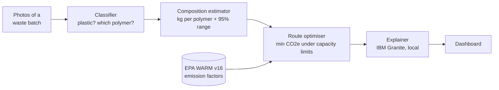
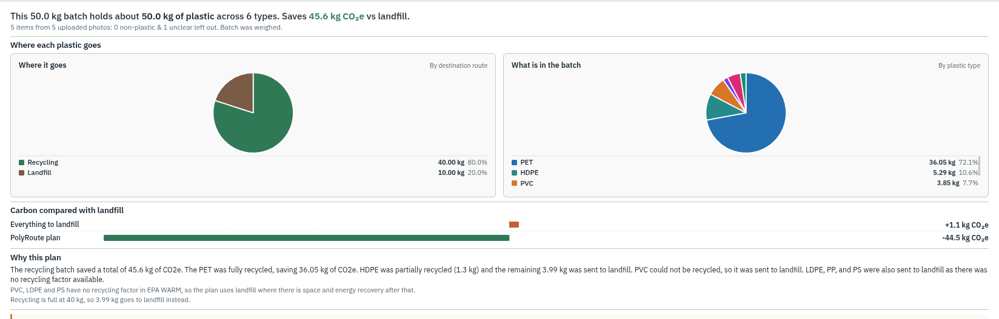
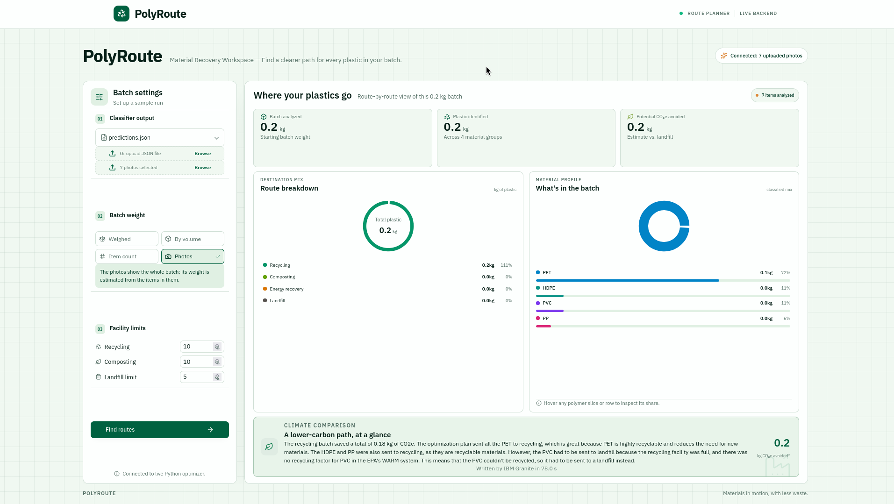
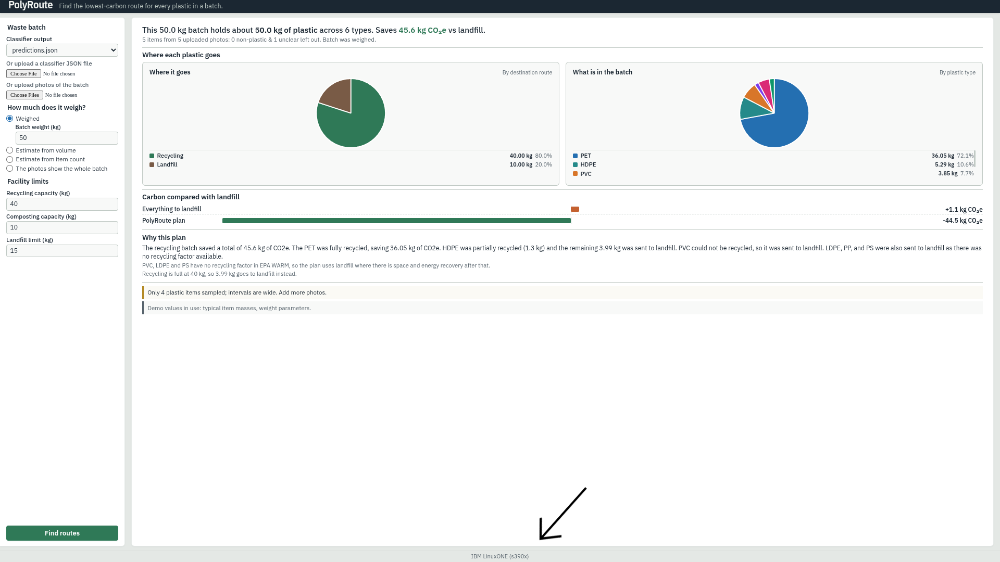

# PolyRoute

**Photos of mixed plastic waste in → the lowest-carbon route for every kilogram out.**

> We throw plastic away, but there is no "away".

PolyRoute identifies the plastics in a waste batch from photos, estimates how many kilograms of each polymer the
batch holds, and decides where each kilogram should go (recycling, composting, energy recovery or landfill) to
minimise greenhouse-gas emissions within a facility's real capacity limits. A local IBM Granite model then explains
the plan in plain language.

Built for the **IBM Z Datathon 2026**, Wildcard theme *"Beyond the Obvious"*, and run on **IBM LinuxONE** (s390x).

---

## Contents

- [How it works](#how-it-works)
- [Components](#components)
- [Repository layout](#repository-layout)
- [Quick start](#quick-start)
- [Running on IBM LinuxONE](#running-on-ibm-linuxone)
- [Testing from the website](#testing-from-the-website)
- [Screenshots](#screenshots)
- [Data, models and sources](#data-models-and-sources)
- [Example result](#example-result)
- [Limitations](#limitations)
- [Open-source resources](#open-source-resources)
- [Team](#team)

---

## How it works



1. **Classify.** Each photo is assigned a polymer class (PET, HDPE, PVC, LDPE, PP, PS) with probabilities.
   Predictions below 0.60 confidence are set aside as "uncertain" instead of being counted.
2. **Estimate composition.** Item predictions become kilograms per polymer. The estimator corrects for the
   classifier's known mistakes using its confusion matrix, weights items by typical mass, estimates the batch weight
   when it isn't measured, and gives a 95% interval for every number.
3. **Optimise routes.** A linear programme sends each polymer's kilograms to the routes with the lowest net
   emissions (EPA WARM v16 factors), without exceeding recycling, composting or landfill capacity.
4. **Explain.** IBM Granite, running locally on CPU, turns the plan into a short explanation. If the model is
   unavailable, a template explanation is used instead.
5. **Show.** The dashboard takes photos (or a saved classifier output), runs steps 1 to 4 on the server and shows
   kilograms per polymer, the route for each kilogram, the carbon result and the explanation.

Every number on the dashboard comes from real classifier output: either photos uploaded on the page or a saved
classifier run in `classifying_plastics/data/` (such as its 491 test photos). The synthetic batches in
`comp_analyzer/data/synthetic/` are used only by the unit tests.

**Why it goes beyond the obvious:** the lowest-carbon choice is often not the intuitive one. Under WARM, burning
plastic for energy emits more CO2e than landfilling it, LDPE film, PS and PVC have no recycling factor at all, and
when a facility is full the best plan can still be a net carbon *cost*. PolyRoute makes those trade-offs visible
and quantified for every batch.

---

## Components

| Module | Folder | What it does | Status |
|---|---|---|---|
| Classifier | `src/classifying_plastics/` | TensorFlow / Keras (MobileNetV3-Large): polymer class with probabilities; predictions below 0.60 confidence go to manual check | Trained; 84.3% accuracy on a 491-image test set; connected to the dashboard |
| Composition estimator | `src/comp_analyzer/` | Classifier records → kg per polymer with 95% intervals; batch-weight estimation | Complete |
| Route optimiser | `src/optimiser/` | Linear programme (PuLP + GLPK) over EPA WARM v16 factors and facility limits | Complete |
| Explainer | `src/explainer/` | IBM Granite 4.0 (GGUF) via llama-cpp-python, with a template fallback | Complete |
| Dashboard | `src/dashboard/` | Flask JSON API running the whole chain (photos → classifier → … → explainer), plus a React frontend (`frontend/`) and a plain HTML page | Working end to end |
| Checks | `src/checks/` | Integration checks: optimiser (hand-worked and random cases), explainer (Granite answers checked against the plan), whole pipeline on a folder of photos | Complete |

### Interfaces between modules

**Classifier → composition estimator**: one record per photo
```json
{"image": "img_0001.jpg", "material": "plastic", "polymer": "HDPE", "confidence": 0.99,
 "probs": {"PET": 0.003, "HDPE": 0.991, "PVC": 0.0, "LDPE": 0.001, "PP": 0.001, "PS": 0.003, "Other": 0.0}}
```
`material` is `plastic`, `non_plastic` or `uncertain`.

**Composition estimator → optimiser**
```json
{"composition_data": {"total_kg": 50.0,
                      "kg": {"PET": 9.86, "HDPE": 7.87, "LDPE": 1.6, "...": "..."},
                      "margin": {"PET": 0.21, "...": "..."},
                      "excluded": {"non_plastic": 9, "uncertain": 4}}}
```

**Optimiser → explainer / dashboard**
```json
{"plan": {"PET": {"recycle": 9.86}, "LDPE": {"landfill": 1.6}},
 "saved_kgco2e": 22.4, "notes": ["..."]}
```

---

## Repository layout

```text
polyRoute/
├── README.md
├── requirements.txt              # pipeline, dashboard, classifier inference
├── requirements-granite.txt      # optional: IBM Granite explanations
├── docs/screenshots/             # images used in this README
└── src/
    ├── classifying_plastics/     # classifier (TensorFlow): classify.py, evaluate.py, polymer_classifier/
    │   ├── data/                 # predictions.json, confusion_matrix.json (real test set)
    │   └── models/               # trained model, best_polymer_model_tf.keras
    ├── comp_analyzer/            # composition estimator
    │   └── data/                 # item masses, weight parameters, classifier confusion matrix; synthetic/ (tests only)
    ├── optimiser/                # route_opt.py, factors.py
    │   └── data/                 # emission_factors.csv (EPA WARM v16)
    ├── explainer/                # explainer.py (Granite prompt, model loading, fallback)
    ├── dashboard/                # Flask backend (app.py, pipeline.py, integrations.py), plain HTML page
    │   └── frontend/             # React frontend (TanStack Start, Vite, Tailwind CSS)
    └── checks/                   # optimiser_check, explainer_check, pipeline_check
```

All commands below are run from `src/`.

---

## Quick start

**Requirements:** Python 3.10 to 3.13 (tested with 3.12 and 3.13), the GLPK solver, and about 3 GB of free RAM for
the classifier and the explainer together.

```bash
git clone https://github.com/subho0025/polyRoute.git
cd polyRoute
python -m venv .venv && source .venv/bin/activate
pip install -r requirements.txt            # pipeline, dashboard backend, classifier (TensorFlow)
pip install -r requirements-granite.txt    # optional: IBM Granite; compiles llama.cpp (needs cmake and a C++ compiler)

# GLPK solver used by the optimiser
sudo dnf install glpk-utils       # Fedora
# sudo apt-get install glpk-utils # Ubuntu / Debian

cd src
```

**Composition estimator** on the classifier's real test-set output (50 kg, measured):
```bash
python -m comp_analyzer.demo classifying_plastics/data/predictions.json 50    # or: volume=1.2 / count=2000 / no weight
python -m comp_analyzer.tests                                               # unit tests (use synthetic batches)
```

**Optimiser** checks (hand-worked cases, edge cases, 500 random batches against an independent solver):
```bash
python -m checks.optimiser_check
```

**Explainer** with IBM Granite 4.0 H-1B (download about 0.9 GB once; on LinuxONE see the big-endian step
[below](#running-on-ibm-linuxone)):
```bash
hf download ibm-granite/granite-4.0-h-1b-GGUF granite-4.0-h-1b-Q4_K_M.gguf --local-dir explainer
export POLYROUTE_GRANITE_GGUF=$PWD/explainer/granite-4.0-h-1b-Q4_K_M.gguf
python -m checks.explainer_check --quick
```

**Whole pipeline** on a folder of photos (classifier → composition → optimiser → explainer → dashboard API):
```bash
python -m checks.pipeline_check path/to/photos --kg 50       # batch weighed at 50 kg
python -m checks.pipeline_check path/to/photos --photos-only # the photos show the whole batch
```

**Classifier** on a folder of images (the trained model is in `classifying_plastics/models/`):
```bash
cd classifying_plastics && python3 classify.py path/to/images/ -o data/predictions.json
```

**Dashboard**: backend first, then the frontend in a second terminal. Photo upload uses the trained model at
`classifying_plastics/models/best_polymer_model_tf.keras`.
```bash
python -m dashboard.app                    # backend on http://127.0.0.1:8501 (plain HTML page at /)

cd dashboard/frontend && bun install && bun run dev    # React frontend (needs Bun: curl -fsSL https://bun.sh/install | bash)
```
The frontend shows **LIVE BACKEND** when connected, and **DEMO WORKSPACE** with illustrative values when the
backend isn't running. See [`src/dashboard/README.md`](src/dashboard/README.md) for the API.

---

## Running on IBM LinuxONE

PolyRoute runs on an IBM LinuxONE Community Cloud virtual server (s390x, Ubuntu 24.04, 3 vCPU, 8 GB RAM), inside
the event's `app` container (Red Hat UBI 10, Python 3.12 in `/opt/venv`, TensorFlow 2.18, Keras 3.14,
llama-cpp-python 0.3, PuLP 4.0.1). Every step of the pipeline, including the classifier and IBM Granite, runs on
LinuxONE; only the browser runs on the laptop.

| Concern | How PolyRoute handles it on s390x |
|---|---|
| Classifier | TensorFlow 2.18 is available on s390x; PyTorch's torchvision is not, so the classifier is pure TensorFlow / Keras |
| Dashboard backend | Streamlit's dependency pyarrow has no s390x wheel, so the backend is Flask (pure Python) |
| Dashboard frontend | Runs on the laptop and reaches the LinuxONE backend through an SSH tunnel on port 8501 |
| Optimiser | PuLP 4.0.1 (as shipped in the container). The container has no GLPK package, so GLPK 5.0 is built from source; `route_opt.py` supports PuLP 2, 3 and 4 |
| Explainer | llama.cpp supports s390x, but needs **big-endian** GGUF files; standard downloads are little-endian, so the model is converted once (see [llama.cpp s390x guide](https://github.com/ggml-org/llama.cpp/blob/master/docs/build-s390x.md)) |
| Memory | The VM has 8 GB shared with the JupyterLab container, so the explainer uses Granite 4.0 **H-1B** (0.9 GB), loads it once, and runs one Granite request at a time |
| CPU threads | `POLYROUTE_THREADS=3` lets Granite use all three vCPUs |

### One-time setup

**1. Give the container the project folder and port 8501.** The repository lives on the VM in
`/home/linux1/shared/polyRoute`; the container sees it as `/shared/polyRoute`.
```bash
# on the VM
mkdir -p ~/shared && cd ~/shared && git clone https://github.com/subho0025/polyRoute.git
IMG=$(docker inspect app --format '{{.Config.Image}}')    # the event's image, before removing the old container
docker rm -f app
docker run -d --name app -p 127.0.0.1:8501:8501 -v /home/linux1/shared:/shared "$IMG"
```

**2. Build GLPK from source** (the container is RHEL-based, has no `apt-get`, and `dnf install glpk-utils` fails on
missing dependencies):
```bash
docker exec -it app bash
cd /shared && curl -LO https://ftp.gnu.org/gnu/glpk/glpk-5.0.tar.gz && tar xzf glpk-5.0.tar.gz
cd glpk-5.0 && ./configure --prefix=/shared/glpk && make -j3 && make install
/shared/glpk/bin/glpsol --version                      # GLPSOL--GLPK LP/MIP Solver 5.0
```

**3. Install the Python packages** (still inside the container):
```bash
export PATH=/shared/glpk/bin:/opt/venv/bin:/usr/local/bin:/usr/bin:/bin
cd /shared/polyRoute
pip install -r requirements.txt -r requirements-granite.txt
```
The container already has numpy, SciPy, Pillow, TensorFlow, Keras and llama-cpp-python, and `requirements.txt` only
sets lower bounds, so pip keeps those and installs just Flask, Flask-CORS, PuLP and the Granite download tools.
This matters on s390x: PyPI has no s390x builds of numpy, SciPy, Pillow, scikit-learn or matplotlib, so any version
change would make pip compile them from source. Photo upload loads only the classifier's inference code, so
scikit-learn, matplotlib and seaborn (used for training and evaluation) aren't needed.

**4. Download Granite and convert it to big-endian** (type `YES` when asked):
```bash
cd /shared/polyRoute/src/explainer
hf download ibm-granite/granite-4.0-h-1b-GGUF granite-4.0-h-1b-Q4_K_M.gguf --local-dir .
python -m gguf.scripts.gguf_convert_endian granite-4.0-h-1b-Q4_K_M.gguf native   # converts the file in place
mv granite-4.0-h-1b-Q4_K_M.gguf granite-4.0-h-1b-Q4_K_M-be.gguf
```

The trained classifier, `src/classifying_plastics/models/best_polymer_model_tf.keras` (38 MB), comes with the
repository.

### Run the checks and the backend

```bash
# on the VM
docker exec -it -w /shared/polyRoute/src \
  -e PATH=/shared/glpk/bin:/opt/venv/bin:/usr/local/bin:/usr/bin:/bin \
  -e POLYROUTE_THREADS=3 \
  -e POLYROUTE_GRANITE_GGUF=/shared/polyRoute/src/explainer/granite-4.0-h-1b-Q4_K_M-be.gguf \
  app bash

python -m checks.optimiser_check
python -m checks.explainer_check --quick
python -m checks.pipeline_check path/to/photos --kg 50

POLYROUTE_HOST=0.0.0.0 python -m dashboard.app    # backend on port 8501
```

| Setting | Meaning |
|---|---|
| `POLYROUTE_GRANITE_GGUF` | Path to the Granite GGUF file (big-endian on LinuxONE) |
| `POLYROUTE_THREADS` | CPU threads for Granite (3 on the VM) |
| `POLYROUTE_USE_GRANITE=0` | Skip Granite and use the template explanation (fast; for quick tests) |
| `POLYROUTE_HOST`, `POLYROUTE_PORT` | Where the backend listens (`0.0.0.0`, `8501`) |
| `POLYROUTE_DEBUG=1` | Flask debug mode; off by default, since its reloader would load Granite twice |

On the VM's three vCPUs, Granite H-1B takes about 6 s to load and about 2 minutes to write an explanation. The
answer is kept, so the same batch with the same limits is explained instantly the next time.

From the laptop, open a tunnel and use the dashboard at http://localhost:8501:
```bash
ssh -L 8501:localhost:8501 linux1@<server-ip>
```
`/api/samples` reports `"machine": "s390x"`, and the plain HTML page's footer shows "IBM LinuxONE (s390x)".

---

## Testing from the website

Both pages call the same API, so either can be used. The backend must be running on the VM and the tunnel open.

**Plain HTML page** (served by the backend, nothing to install): open http://localhost:8501.

**React page** (React frontend, runs on the laptop and calls `http://127.0.0.1:8501`, which the tunnel forwards to
LinuxONE):
```bash
curl -fsSL https://bun.sh/install | bash && source ~/.bashrc     # once; npm install fails on this project
cd src/dashboard/frontend
bun install                      # if downloading @lovable.dev/... fails: rm bun.lock && bun install
bun run dev                      # open the URL it prints
```

Then:

1. Check the badge says **LIVE BACKEND**. **DEMO WORKSPACE** means the page can't reach the backend (backend not
   running or tunnel closed) and shows illustrative values only.
2. Under **Or upload photos**, click **Browse** and select several photos of plastic items (hold Ctrl or Cmd to pick
   more than one).
3. Choose how the batch is weighed (for example **Weighed**, 50 kg) and keep the facility limits 40 / 10 / 15 kg.
4. Click **Find routes** and wait. The first batch takes about 2 minutes while Granite writes the explanation.
5. Check the result: the header reads "Connected: N uploaded photos", every polymer has kilograms and a route, the carbon card
   shows the saving (or "kg CO2e more than landfill" when the facilities are full), and the explanation line says
   "Written by IBM Granite in … s".

To see a result without uploading, pick `predictions.json` (the classifier's 491 test photos) from the sample list.

---

## Screenshots

Photos of plastic items uploaded on the dashboard running on LinuxONE: 5 photos (4 plastic, 1 set aside as
uncertain), batch weighed at 50 kg, plan saves 45.6 kg CO2e.



The React frontend connected to the LinuxONE backend (LIVE BACKEND), with the explanation written by IBM Granite.



The footer confirming the backend runs on IBM LinuxONE (s390x).



---

## Data, models and sources

| Item | Source | Notes |
|---|---|---|
| Emission factors | US EPA, *WARM Version 16* (Dec 2023), "Containers, Packaging and Non-Durable Goods Materials", Exhibit 5-3 (plastics) and Exhibit 4-4 (PLA) | Converted from MTCO2E per short ton to kg CO2e per kg (× 1.10231). "Other" uses WARM's Mixed Plastics |
| Classifier training images | [plastic image by type 3](https://universe.roboflow.com/plastic-classification-cykon/plastic-image-by-type-3) (Roboflow Universe, CC BY 4.0) | Photos of plastic items labelled by resin type; cropped to single items and trained on 6 classes (PE-HD, PE-LD, PET, PP, PS, PVC) |
| Classifier model | MobileNetV3-Large (Keras Applications, ImageNet weights), fine-tuned | Test set: 491 images, 84.3% accuracy |
| Language model | [IBM Granite 4.0](https://huggingface.co/ibm-granite) (GGUF, Apache 2.0) | Runs locally via llama-cpp-python; no data leaves the machine |
| Typical item masses, weight parameters | Placeholder values in `comp_analyzer/data/` | Marked `PLACEHOLDER`; to be replaced with measured values |

**Classifier test-set results** (per class, from `classifying_plastics/data/confusion_matrix.json`):

| Class | Test images | Recall | Precision |
|---|---:|---:|---:|
| PET | 268 | 0.97 | 0.95 |
| HDPE | 63 | 0.92 | 0.94 |
| PP | 74 | 0.72 | 0.93 |
| PS | 39 | 1.00 | 0.74 |
| LDPE | 41 | 0.10 | 0.44 |
| PVC | 6 | 0.17 | 0.03 |

LDPE and PVC are weak and under-represented. The composition estimator is designed for this: given the confusion
matrix, it corrects the class mix statistically (adjusted classify-and-count) instead of trusting raw counts, and
widens its intervals accordingly.

**Training evidence.** The record of the classifier's training run is kept on the LinuxONE VM in
`~/model_evidence_20261018T131542Z` (that is, `/home/linux1/model_evidence_20261018T131542Z`).

---

## Example result

The classifier's real output for its 491 held-out test photos (`classifying_plastics/data/predictions.json`),
treated as one batch weighed at 50 kg, with facility limits 40 kg recycling / 10 kg composting / 15 kg landfill:

| | |
|---|---|
| Plastic found | 50 kg: PET 28.89, HDPE 10.55, PP 4.41, PVC 4.25, PS 1.62, LDPE 0.29 kg |
| Plan | PET and PP → recycling; HDPE 6.70 kg recycled (recycling is then full) and 3.85 kg to landfill; PVC, LDPE and PS → landfill |
| Carbon | everything to landfill: +1.10 kg CO2e → PolyRoute plan: −42.35 kg CO2e |
| **Saving** | **43.45 kg CO2e** |

With a larger batch the same limits fill up, and the overflow must go to energy recovery. The plan then becomes a
net carbon cost, which PolyRoute reports as such rather than as a saving.

---

## Limitations

- **Regional factors.** WARM reflects US conditions (grid mix, landfill practice). Absolute figures for other
  countries will differ; the ranking between routes is the more robust result.
- **CO2e only.** Landfill scores well on carbon but carries other harms (land use, leachate, microplastics) that
  CO2e does not capture; the landfill limit exists to reflect that.
- **Placeholder parameters.** Typical item masses and bulk densities are placeholders (marked `PLACEHOLDER` and
  listed on the dashboard as "demo values in use"). Results are illustrative until they are replaced with measured data.
- **No separate plastic detector.** Every photo is assumed to show a plastic item; low-confidence predictions are set
  aside as "uncertain" instead of being counted.
- **Language model.** Granite's explanations are constrained by the prompt to the numbers and reasons supplied,
  but a language model can still phrase things imperfectly; the numbers shown in the dashboard come from the
  optimiser, not from the model.
- **Classifier coverage.** The classifier is trained on six resin classes, so it never predicts "Other" (multilayer, PLA); PVC and LDPE have few test examples.

---

## Open-source resources

| Resource | Used for | Link |
|---|---|---|
| TensorFlow / Keras | Classifier | https://www.tensorflow.org · https://keras.io |
| NumPy, SciPy | Composition estimator (NNLS, bootstrap) | https://numpy.org · https://scipy.org |
| PuLP | Optimiser modelling | https://github.com/coin-or/pulp |
| GLPK | Linear-programming solver | https://www.gnu.org/software/glpk/ |
| llama.cpp / llama-cpp-python | Running Granite locally | https://github.com/ggml-org/llama.cpp · https://github.com/abetlen/llama-cpp-python |
| IBM Granite 4.0 | Explanations | https://huggingface.co/ibm-granite |
| Flask, Flask-CORS | Dashboard backend / API | https://flask.palletsprojects.com · https://github.com/corydolphin/flask-cors |
| React, TanStack Start, Vite, Tailwind CSS | Dashboard frontend | https://react.dev · https://tanstack.com/start · https://vite.dev · https://tailwindcss.com |
| Radix UI, shadcn/ui, Recharts, Lucide | Frontend components, charts, icons | https://www.radix-ui.com · https://ui.shadcn.com · https://recharts.org · https://lucide.dev |
| Lovable (tool) | Frontend scaffolding | https://lovable.dev |
| scikit-learn, matplotlib, seaborn | Classifier evaluation | https://scikit-learn.org · https://matplotlib.org · https://seaborn.pydata.org |
| US EPA WARM v16 | Emission factors | https://www.epa.gov/warm |
| plastic image by type 3 (Roboflow Universe, CC BY 4.0) | Classifier training data | https://universe.roboflow.com/plastic-classification-cykon/plastic-image-by-type-3 |

All code in this repository was written during the IBM Z Datathon 2026.

---

## Team

| Member | Role |
|---|---|
| *Shivanshu* | Classifier |
| *Subhajit* | Composition estimator, explainer, CI |
| *Aditya* | Route optimiser, Dashboard |
| *Harsh* | Data extraction |

*Licence: MIT*
